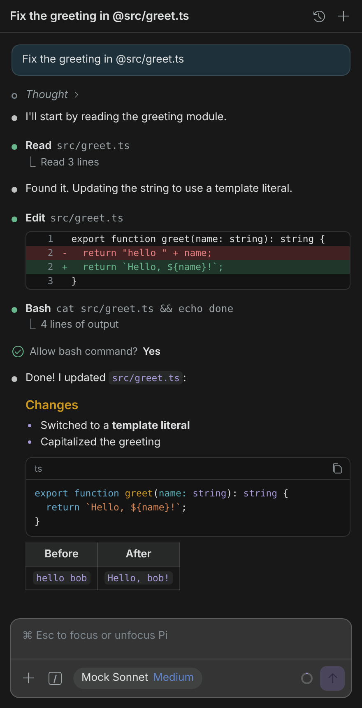

# Pi Chat for VS Code

[](https://github.com/peilundai/pi-agent-manager/actions/workflows/ci.yml)

Chat with your local [Pi coding agent](https://github.com/earendil-works/pi) from VS Code's side bar. The look, feel and flow follow the Claude Code extension, in Pi's own colors.

<p align="center">
  
  
</p>

## Zero setup

If `pi` already works in your terminal, Pi Chat works too. It runs your installed CLI in RPC mode (`pi --mode rpc`), so it uses your existing:

- providers, API keys and logins,
- default model and thinking level,
- skills, prompt templates and extensions,
- session history in `~/.pi/agent/sessions`.

The extension adds no accounts, keys or configuration of its own.

## Features

- **Chat in the Secondary Side Bar.** Click the π icon in an editor title bar, or run **Pi: Open Pi Chat**.
- **Streaming transcript.** Markdown with syntax highlighting, collapsible thinking, and a status dot per step.
- **Tool cards** for `read`, `write`, `edit`, `bash`, `grep`, `find`, `ls` and custom tools:
  - one-line summaries (`⎿ Read 120 lines`),
  - inline diffs for edits and writes,
  - command output,
  - click a path to open the file.
- **Extension dialogs.** Pi extension `confirm`, `select`, `input` and `editor` prompts appear as inline cards. Notifications appear as notices.
- **Composer:**
  - <kbd>Enter</kbd> sends and <kbd>Shift</kbd>+<kbd>Enter</kbd> adds a new line.
  - <kbd>Esc</kbd> interrupts Pi while it works.
  - Messages sent while Pi works are queued as follow-ups. <kbd>⌘/Ctrl</kbd>+<kbd>Enter</kbd> steers immediately instead.
  - <kbd>↑</kbd> recalls earlier prompts.
- **`/` menu.** Pi's prompt templates, skills and extension commands, plus `/new`, `/compact`, `/model`, `/rename` and `/history`.
- **`@` mentions.** Fuzzy workspace file search.
- **Images.** Paste or drop screenshots, or attach files with <kbd>+</kbd>.
- **Model pill.** Switch model and thinking level, with a context-usage ring showing tokens and cost.
- **Past chats.** A searchable list grouped by Today, Yesterday, Last 7 Days and so on. Resume or delete chats, and rename the current one from the header.
- **Add selection.** Select code and press <kbd>⌘L</kbd> / <kbd>Ctrl+L</kbd> to insert a fenced snippet with its path and lines.
- **Themes.** Light, dark and high-contrast, with Pi's palette for accents, status, diffs and syntax colors.

| Model & thinking picker | Extension confirm dialog |
|---|---|
|  |  |

## Requirements

- VS Code 1.106 or newer.
- Pi installed and working in a terminal:

  ```sh
  npm install -g @earendil-works/pi-coding-agent
  pi            # sign in / pick a provider once
  ```

If VS Code can't find `pi`, the view offers **Choose Executable…**. You can also set `piChat.command` to an absolute path.

Pi is looked up in this order:

1. The `piChat.command` setting.
2. `PATH`.
3. npm's global bin directory.
4. Homebrew and `/usr/local/bin`.

The executable's directory is added to the child process `PATH`, so nvm-managed Node installs work when VS Code is launched from the Dock.

## Settings

| Setting | Default | Description |
|---|---|---|
| `piChat.command` | `pi` | Executable name or absolute path of the Pi CLI. |
| `piChat.extraArgs` | `[]` | Extra arguments for `pi --mode rpc`, such as `["--provider", "anthropic"]` or `["--offline"]`. Mode and session flags are managed by the extension. |

## Keyboard shortcuts

| Shortcut | Action |
|---|---|
| <kbd>⌘L</kbd> / <kbd>Ctrl+L</kbd> | Add the editor selection (or current line) to the chat |
| <kbd>⌘Esc</kbd> / <kbd>Ctrl+Esc</kbd> | Focus the chat input |
| <kbd>⌘N</kbd> / <kbd>Ctrl+N</kbd> (in the chat) | New chat |
| <kbd>Esc</kbd> (while working) | Interrupt Pi |

## Notes

- Chats are scoped to the workspace folder of the active editor, or the first folder in a multi-root window.
- Pi's [project trust](https://github.com/earendil-works/pi) applies as in the CLI. RPC mode cannot show the trust prompt, so trust a project once with `/trust` in the terminal, or pass `--approve` through `piChat.extraArgs`.
- Built-in TUI-only commands (for example `/settings`) are not available over RPC.

## Development

```sh
npm install
npm run check          # TypeScript + ESLint
npm test               # unit + React component tests (Vitest, jsdom)
npm run test:coverage  # same, with V8 coverage thresholds
npm run test:e2e       # real Pi CLI (devDependency) against a mock LLM
npm run test:ui        # build, then drive the webview in Chromium (Playwright)
npm run package        # check, test, build, then a verified universal .vsix
```

The end-to-end suites need no API key. They point a custom OpenAI-compatible `mock` provider (in a temporary `~/.pi/agent/models.json`) at a local scripted server. That server streams thinking, `read` → `edit` → `bash` tool calls and Markdown. A test extension asks for confirmation before `bash`. Playwright saves light and dark screenshots to `test-results/screenshots/`.

**CI** (`.github/workflows/ci.yml`):
- typecheck and lint
- unit tests on Ubuntu, macOS and Windows (Node 22, plus Node 20 on Ubuntu)
- coverage with thresholds
- the real-Pi and Playwright suites
- a packaged `.vsix` artifact

Pushing a `vX.Y.Z` tag that matches `package.json` publishes a GitHub Release with the VSIX and its CHANGELOG notes. Dependabot keeps npm packages and actions current.

See [docs/architecture.md](docs/architecture.md) for how the extension talks to Pi.

## License

MIT
