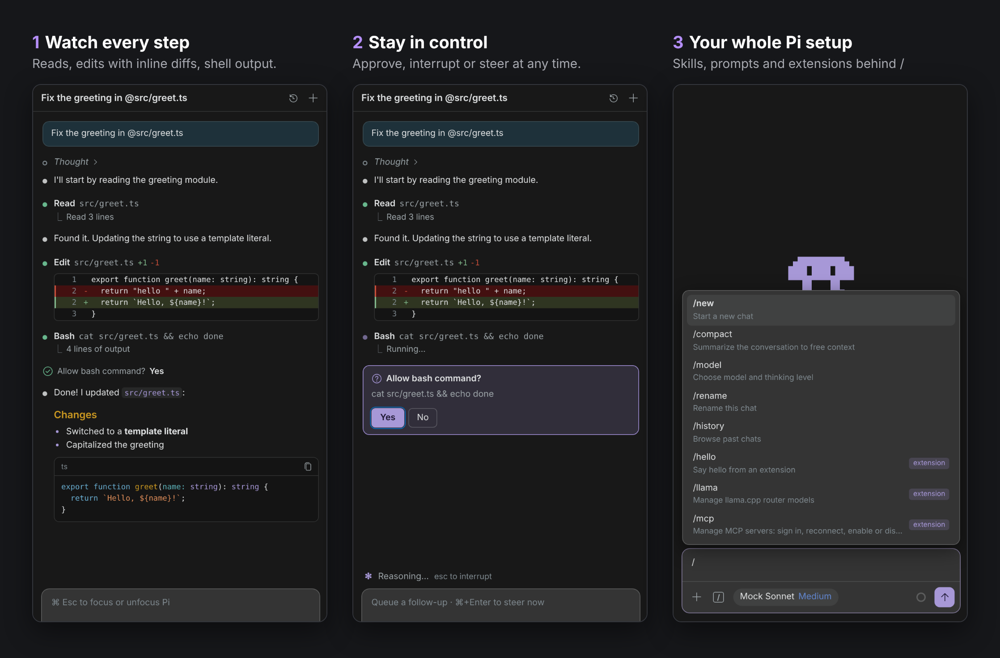
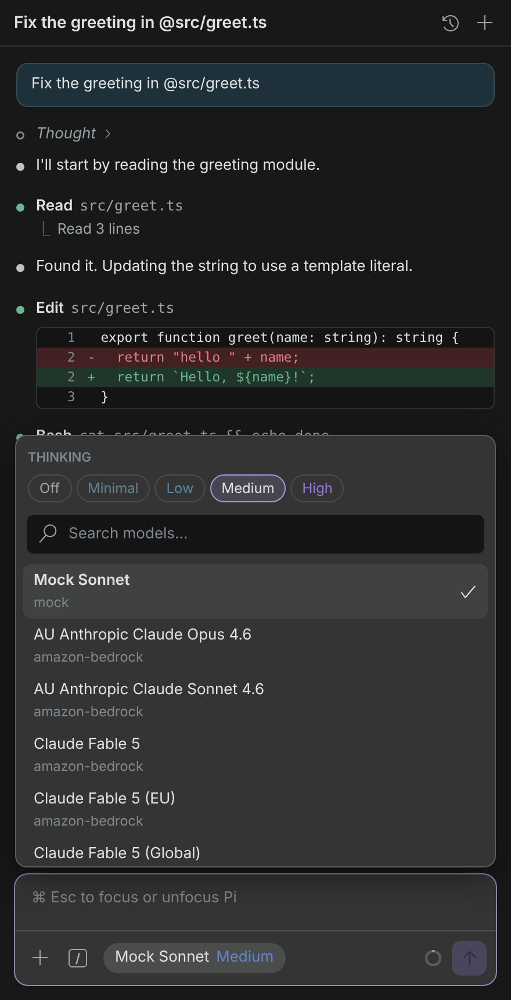
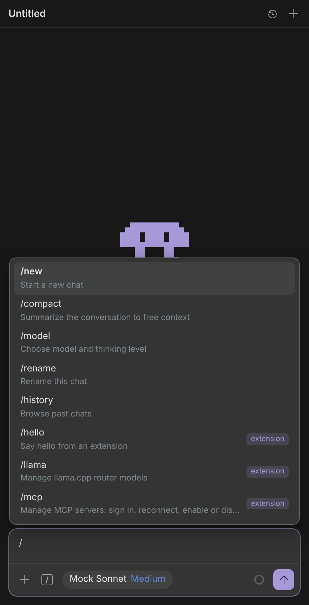
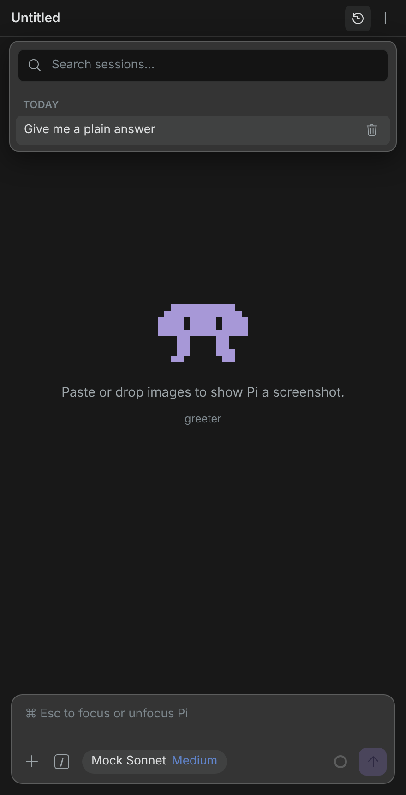
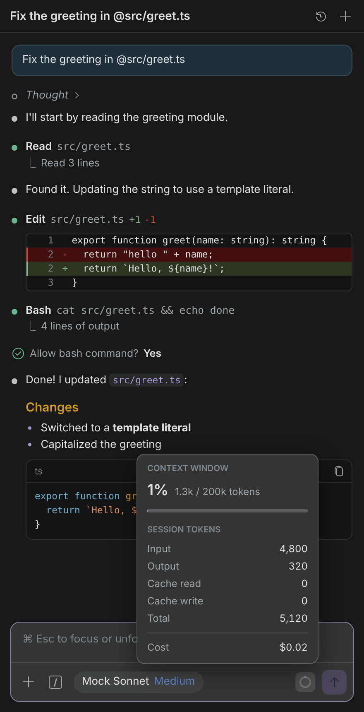
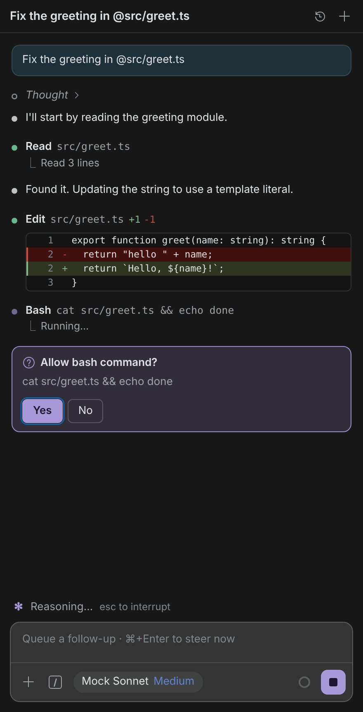
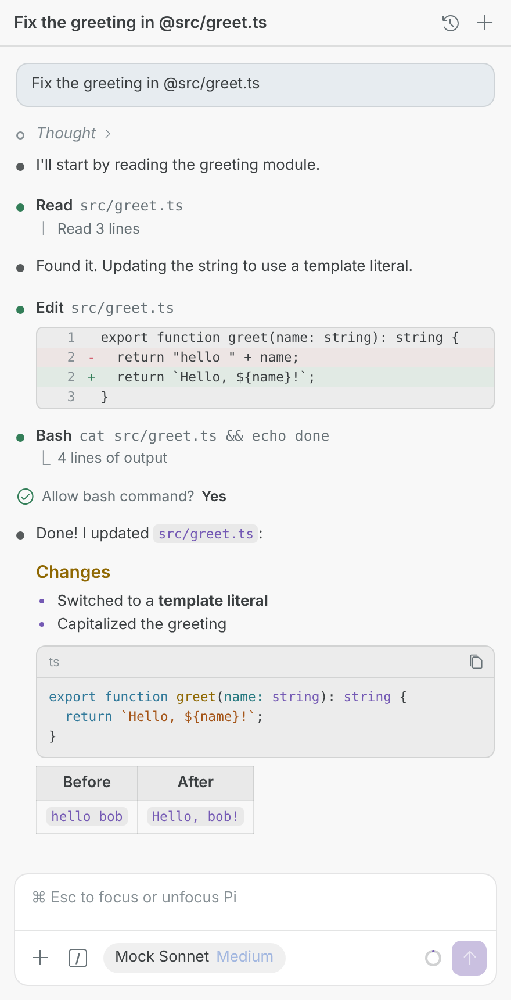

# Pi Agent Manager for VS Code

[](https://github.com/peilundai/pi-agent-manager/actions/workflows/ci.yml)

**The [Pi coding agent](https://github.com/earendil-works/pi), in a VS Code side-bar panel.** Chat next to your code, watch every read, edit and command as it happens, and interrupt or steer Pi at any time. Pi Agent Manager uses the `pi` you already have, so it needs no new account, key or config.

<p align="center">
  
</p>

> **Unofficial, preview.** A community extension, not affiliated with or endorsed by the Pi project. See [Disclaimer](#disclaimer-and-acknowledgements).

## Why use it

| If you… | Pi Agent Manager… |
|---|---|
| switch between a terminal and the editor to check what Pi did | shows each step in the side bar: files read, **inline diffs**, command output. Click a path to open the file. |
| want to stay in control of what Pi does | lets you <kbd>Esc</kbd> to interrupt Pi and <kbd>⌘/Ctrl</kbd>+<kbd>Enter</kbd> to steer it mid-run. Prompts from your Pi extensions, such as a bash confirmation, appear as inline **Yes / No cards**. |
| copy and paste code and paths into the agent | sends your editor selection with the next message (or <kbd>⌥L</kbd> / <kbd>Alt+L</kbd> adds it as an `@file#lines` chip), `@` to mention files, and paste or drop to attach screenshots. |
| lose earlier conversations | keeps **past chats** per workspace, searchable and grouped by day, so you can resume one in a click. |
| use a company gateway or MCP server keyed through env vars | loads your **login-shell environment**, names any variable that's missing, and stores secrets in VS Code's encrypted storage. |
| develop on a remote box over SSH or a tunnel | runs on the **remote host**, next to your code and your remote `pi`. See [Remote development](#remote-development). |

## Get started in 1 minute

1. Install Pi and sign in once in a terminal:
   ```sh
   npm install -g @earendil-works/pi-coding-agent
   pi            # pick a provider / sign in
   ```
2. Install **Pi Agent Manager** from the Marketplace.
3. Click the **π** icon in the editor title bar, or run **Pi Agent Manager: Open**, then start typing.

In VS Code the chat opens in the Secondary Side Bar, on the right. In Cursor that side bar is not available, so the same π icon is on the left activity bar with the other icons. Only one Pi panel is shown.

Pi Agent Manager runs `pi --mode rpc`, so your providers, default model, skills, prompt templates, extensions and session history (`~/.pi/agent`) all just work.

## What's inside

| Pick model & thinking level | `/` for skills, prompts and commands | Past chats |
|---|---|---|
|  |  |  |
| **Context & cost at a glance** | **Extension prompts inline** | **Light, dark & high contrast** |
|  |  |  |

- **Streaming transcript:** Markdown with syntax highlighting, collapsible thinking, and a status dot per step.
- **Tool cards** for `read`, `write`, `edit`, `bash`, `grep`, `find`, `ls` and custom tools, with one-line summaries, diffs and output.
- **Composer:** <kbd>Enter</kbd> sends. Messages sent while Pi works queue as follow-ups. <kbd>↑</kbd> recalls earlier prompts.
- **Extension dialogs:** Pi extension `confirm`, `select`, `input` and `editor` prompts appear as inline cards. Pi Agent Manager doesn't add its own approval step: to confirm commands before they run, install a Pi extension that asks for confirmation.
- **Multi-root aware:** each chat stays in its own workspace folder, and you can switch folders from the header.
- **Private:** no telemetry, and no network calls of its own. Your prompts go only to your local `pi`.

### Keyboard shortcuts

| Shortcut | Action |
|---|---|
| <kbd>⌥L</kbd> / <kbd>Alt+L</kbd> | Add the selection (or current line) to the chat |
| <kbd>⌃⌘P</kbd> / <kbd>Ctrl+Alt+P</kbd> | Focus the chat input |
| <kbd>⌘N</kbd> / <kbd>Ctrl+N</kbd> (in chat) | New chat |
| <kbd>Esc</kbd> (while working) | Interrupt Pi |
| <kbd>⌘/Ctrl</kbd>+<kbd>Enter</kbd> (while working) | Steer now instead of queueing |

These defaults leave VS Code's <kbd>⌘L</kbd> / <kbd>Ctrl+L</kbd> (**Expand Line Selection**) and other chat extensions' shortcuts alone. On macOS, <kbd>⌥L</kbd> takes over typing `¬` while an editor has focus. To use a different shortcut, rebind **Pi Agent Manager: Add Selection to Chat** in **Keyboard Shortcuts**.

## Remote development

Pi Agent Manager works with **Remote-SSH, Remote Tunnels, WSL and Dev Containers**. VS Code runs it on the remote host, which means:

- it starts the **remote** `pi`, in the remote workspace folder,
- it uses the remote `~/.pi/agent` for logins, models and history,
- it loads the remote login shell's environment.

The chat panel still shows locally. To set it up:

1. Install and sign in to Pi **on the remote machine**. A local Pi install isn't used.
2. Install the extension in the remote window (**Install in SSH: ‹host›** in the Extensions view).
3. If `pi` isn't on the remote `PATH`, set `piAgentManager.command` in the **Remote** settings tab.

Not supported: browser-only virtual workspaces, such as github.dev or vscode.dev without a tunnel. Pi needs a real filesystem and a machine to run on. Attach images with the **+** button or by pasting. Files dragged in from your local disk may not reach the remote.

## API keys, gateways and MCP tokens

Pi often reads keys from environment variables, such as `"apiKey": "${GATEWAY_API_KEY}"` in `models.json` or `"Bearer ${DOCS_TOKEN}"` in `mcp.json`. A VS Code window opened from the Dock doesn't run your shell startup files, so those variables can be missing even though `pi` works in your terminal. Pi Agent Manager fixes this:

1. **Login-shell environment.** It asks your login shell once per window for its variables and missing `PATH` entries. It never overrides a variable VS Code already has. If the shell fails or takes more than 10 s, Pi starts anyway and the reason is logged to the **Pi Agent Manager** output channel.
2. **Missing-variable check.** If a variable referenced in `models.json` or `mcp.json` is still unset, it names the variable and offers **Set Secret…**.
3. **Encrypted secrets.** **Set Environment Secret…** stores a value in VS Code's secret storage and passes it only to Pi. **Remove Environment Secret…** deletes one.

Other commands: **Reload Environment and Restart Pi** and **Show Environment Diagnostics**. Values are never shown or logged.

<details>
<summary><b>Finding the <code>pi</code> executable</b></summary>

If VS Code can't find `pi`, the view offers **Choose Executable…**. Otherwise, Pi is looked up in this order:

1. The `piAgentManager.command` setting.
2. `PATH`.
3. npm's global bin directory.
4. Homebrew and `/usr/local/bin`.

The executable's directory is added to Pi's `PATH`, so nvm-managed Node installs work too.

</details>

<details>
<summary><b>Settings</b></summary>

| Setting | Default | Description |
|---|---|---|
| `piAgentManager.command` | `pi` | Executable name or absolute path of the Pi CLI. |
| `piAgentManager.extraArgs` | `[]` | Extra arguments for `pi --mode rpc`, such as `["--provider", "anthropic"]`. Mode and session flags are managed for you. |
| `piAgentManager.loadShellEnvironment` | `true` | Add your login shell's variables (API keys, gateway settings, `PATH`) to Pi's environment. Not used on Windows. |
| `piAgentManager.environment` | `{}` | Extra variables for Pi, such as a gateway base URL. Put keys in **Set Environment Secret…** instead. |
| `piAgentManager.expandToolCards` | `edits` | Which tool cards start expanded: `edits`, `all` or `none`. |
| `piAgentManager.maxContentWidth` | `800` | Maximum transcript width in pixels. `0` fills the view. |

</details>

<details>
<summary><b>Notes and limits</b></summary>

- History is scoped to one workspace folder: only chats Pi ran in that exact folder are listed.
- In multi-root windows, an empty chat follows the active editor's folder. A chat with messages stays in its folder. Use the folder button in the header or **Switch Workspace Folder** to switch.
- Pi's project trust applies. RPC mode can't show the trust prompt, so run `/trust` once in a terminal, or pass `--approve` through `piAgentManager.extraArgs`.
- TUI-only commands, such as `/settings`, aren't available over RPC.

</details>

<details>
<summary><b>Development</b></summary>

```sh
npm install
npm run check          # TypeScript + ESLint
npm test               # unit + React component tests (Vitest)
npm run test:coverage  # with coverage thresholds
npm run test:e2e       # real Pi CLI against a mock LLM (no API key)
npm run test:ui        # Playwright webview tests; saves screenshots to test-results/screenshots/
npm run package        # verified universal .vsix
```

See [docs/architecture.md](docs/architecture.md) for how the extension talks to Pi, and [docs/PUBLISHING.md](docs/PUBLISHING.md) for releases.

</details>

## Disclaimer and acknowledgements

- Pi Agent Manager is an independent, unofficial client for the [Pi coding agent](https://github.com/earendil-works/pi). It is not affiliated with, endorsed by or sponsored by the Pi project or its authors. "Pi" refers to that third-party project.
- The extension does not include or redistribute any Pi code. It starts the `pi` executable you installed yourself, so Pi's own license and terms apply to it.
- The color palette is adapted from Pi's MIT-licensed themes (Copyright (c) Mario Zechner). Bundled third-party packages and their licenses are listed in [THIRD_PARTY_NOTICES.md](THIRD_PARTY_NOTICES.md).
- The π icon and mascot are original artwork for this extension.

## License

MIT. See [LICENSE](LICENSE) and [THIRD_PARTY_NOTICES.md](THIRD_PARTY_NOTICES.md).
